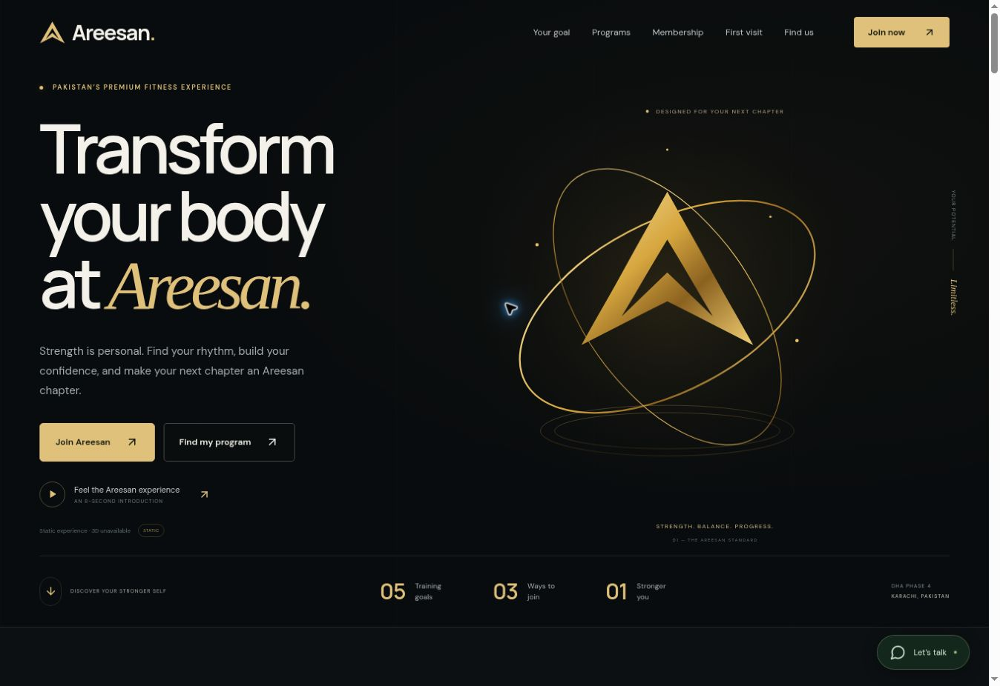

# Areesan — an interactive fitness experience

A responsive Next.js website with five procedural Three.js scenes, five Remotion compositions, and Framer Motion interactions. The redesign follows the black-and-gold Areesan identity without needing real gym photography, equipment specifications, or a floor plan.



[View the mobile preview](docs/interactive-mobile.jpg)

## Run and deploy

Requires Node.js 20.9 or newer.

```sh
npm ci
npm run dev
npm run typecheck
npm run build
```

The build creates a static export in `out/`. Import this repository into Vercel, select the **Next.js** preset, leave the root directory as `./`, and keep the default build settings. No environment variables or backend services are required. The checked-in video, font, and poster files are included in the export.

Development uses `.next-dev/` so production builds can run without corrupting the development cache. The Vercel repository uses the standard `next dev` command.

## The visitor journey

| Section | What the visitor can do |
| --- | --- |
| Brand hero | Explore an emblem with metallic orbits, pointer-responsive depth, procedural weight plates, and an eight-second brand film |
| Goal finder | Choose one of five goals, experience, training days, and coaching preference |
| Why Areesan | Explore five benefit segments through a 3D progress ring and accessible buttons |
| Programs | Browse an editorial layout and open a Remotion explainer for each program |
| Training journey | Follow four scroll-linked 3D checkpoints or choose a checkpoint with keyboard-accessible tabs |
| Membership | Swipe, click, or use buttons to compare three podium panels, prices, inclusions, and best-fit descriptions |
| Testimonials | Read the existing concept quotes with seven-second rotation, manual controls, hover/focus pause, and a pause button |
| First visit | Watch a five-step Remotion introduction with a readable text transcript |
| Your starting plan | See a personalized composition, selected program, membership, training days, and experience |
| Location and enquiry | Use the DHA Phase 4 Google Map, prepare an enquiry, and review a contextual WhatsApp message |

All primary actions lead to program discovery, membership selection, a trial enquiry, or a WhatsApp conversation. Mobile has a compact persistent booking bar.

## Shared content and recommendation rules

`lib/content.ts` is the source of truth for goals, programs, prices, benefits, and contact links. `app/page.tsx` owns the visitor's selections and shares them across the page, Remotion input props, booking form, and WhatsApp text.

Each goal supplies a starting membership. Coaching preference then updates the suggestion:

| Preference | Suggested plan |
| --- | --- |
| Independent training | Basic |
| A personal plan and guidance | Premium |
| Dedicated one-to-one coaching | Premium Plus |

Visitors can override the suggested plan in the membership comparison. Training days and experience personalize the enquiry; they do not imply a medical assessment or guaranteed outcome.

## Three.js architecture

`components/three/` contains the brand scene, goal orbit, journey, membership podium, progress ring, and shared renderer. React Three Fiber manages the canvas and Drei supplies rounded geometry, HTML labels, and procedural environment lighting.

- Geometry is generated in code. There are no GLB files, HDR downloads, or image textures to load or compress.
- Three.js is dynamically imported only for a visible eligible scene.
- A shared visibility budget allows at most two active canvases.
- Scenes unmount when they leave the viewport and stop when the tab is hidden.
- Mobile uses fewer particles, lower pixel density, and no post-processing or real-time shadows.
- Reduced motion, unavailable WebGL, low-memory devices, and data-saving mode receive complete static alternatives.
- A visitor can enable or disable 3D when WebGL is available. Runtime errors or context loss restore the poster instead of breaking the page.

The posters include a branded emblem, a goal orbit, four journey checkpoints, and a responsive membership podium. All selections remain usable through normal HTML controls.

## Remotion and brand media

`components/remotion/` contains the brand introduction, program explainer, first-visit guide, testimonial composition, recommendation composition, and a shared Player wrapper. Interactive compositions receive content IDs instead of duplicated business information.

Players are lazy-loaded, pause offscreen or in a hidden tab, and show a final readable frame for reduced-motion users. The hero uses pre-rendered media rather than an always-running Remotion Player.

The eight-second brand film is committed in MP4 and WebM, with a JPEG poster in `public/media/`. To regenerate it, install FFmpeg on the development machine and run:

```sh
npm run render:brand
```

The script rasterizes `BrandFrame.tsx`, the same SVG frame timeline used by the Remotion brand composition, through Sharp and FFmpeg. It does not need Chromium. Vercel serves the already-generated files and does not need FFmpeg or a rendering service.

## Enquiries and WhatsApp

The trial form validates the name, phone length, and future visit time. It prepares a summary in browser memory. The visitor can edit it, download it, or explicitly continue to WhatsApp. The message contains the selected goal, program, plan, training rhythm, preferred visit, and entered contact details.

No form is submitted to a server, and no appointment is marked as confirmed. No personal form values are stored in local storage or sent to analytics.

Before using the site for real gym enquiries, replace `contact.whatsappNumber` and `contact.displayPhone` in `lib/content.ts`. They currently retain the original concept number, **+92 300 1234567**, which the interface identifies as a demo number. The Google Map shows the DHA Phase 4 area; it is not a verified gym-address pin.

## Analytics integration point

`lib/analytics.ts` emits a browser event named `areesan:analytics`. There is no external analytics SDK or collection endpoint until you attach one. Events cover goal selection, preferences, program exploration, plan selection, trial CTAs, prepared enquiries, WhatsApp redirects, and map directions. Payloads exclude names, phone numbers, dates, and message contents.

```ts
window.addEventListener('areesan:analytics', (event) => {
  const { event: name, properties } = (event as CustomEvent).detail;
  // Pass name and properties to your chosen analytics provider.
});
```

## Accessibility and verification

The interface uses native dialogs with focus restoration and Escape dismissal, labeled form controls, visible focus indicators, keyboard-operable selections, manual animation controls, reduced-motion support, and text equivalents for the cinematic content.

See `docs/VERIFICATION.md` for the checks performed and the environment limits. No Lighthouse score or conversion increase is claimed without measurement.

## Content to verify before business launch

Prices, trial terms, membership inclusions, and the retained sample testimonials come from the original concept. The interface labels those details as illustrative. Real member reviews, gym images, equipment lists, trainer credentials, exact opening hours, and facility models have intentionally not been invented.

The original generated photographs remain in `public/images/` for future use but are not fetched by the redesigned homepage. `ASSETS.md` preserves their original generation notes. DM Sans and Manrope are self-hosted as WOFF2 files, with their SIL Open Font Licenses included in `public/fonts/`.
