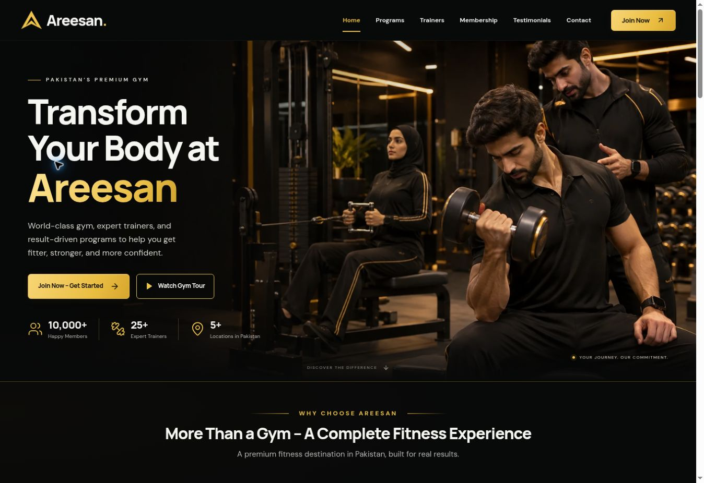

# Areesan

A complete black-and-gold gym website built with Next.js, React, TypeScript, and Framer Motion.

## Development

Install dependencies with `npm install`, then run `npm run dev`. Run `npm run typecheck` to check TypeScript and `npm run build` to create the production static export in `out/`.

## Deploy on Vercel

1. Import this GitHub repository in Vercel.
2. Keep the detected framework preset as **Next.js**.
3. Leave the root directory as `./`.
4. Keep the default install and build settings, then select **Deploy**.

No environment variables or external backend services are required for the current website. Vercel detects the Next.js project and runs the `build` script automatically.

## Experience

- Responsive navigation and active section highlighting
- Scroll reveals, hero parallax, animated counters, and card interactions
- Program details, coach profiles, transformation stories, and facility dialogs
- Four-stop interactive gym photo tour
- Membership-specific trial enquiry form with field validation and downloadable summary
- Keyboard-accessible native dialogs and reduced-motion support

## Content and integration

The trial form is a browser-only demonstration. No bookings or personal information are transmitted or stored on a server. A backend or CRM connection is needed for live enquiries. Sample pricing, profiles, member stories, statistics, and contact details must be verified before business launch. Social links open their platforms, the embedded Google Map shows DHA Phase 4, Karachi, and WhatsApp links use the displayed preview number +92 300 1234567.

All 13 generated photographs are optimized and included in `public/images/`. See `ASSETS.md` for their prompts. Core content is in `app/page.tsx`; the responsive design is in `app/globals.css`.
